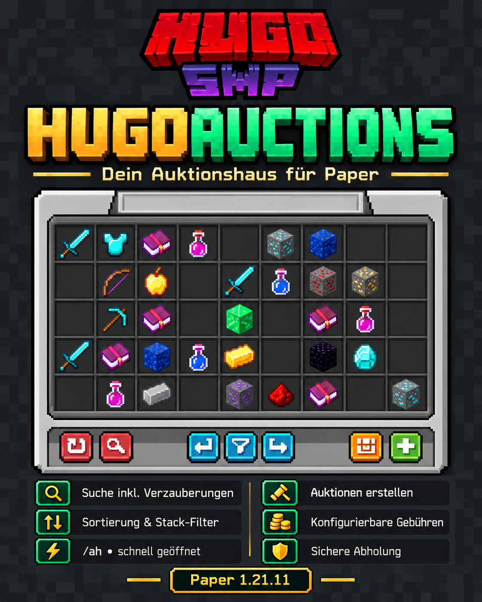
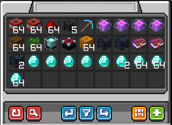
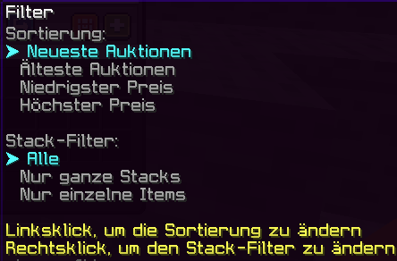

## DOWNLOAD

**Interesse am Skript/Plugin?** Add **AliOG1337** auf Discord.

# HugoSMP - Auction | Minecraft Paper Auction House Plugin

### HugoAuctions – Auktionshaus inspiriert an HugoSMP.net

**HugoAuctions** ist das Minecraft Paper Auction House Plugin und Auktionshaus-Plugin für HugoSMP. Mit `/ah` öffnen Spieler das Auktionshaus, durchsuchen Angebote und stellen eigene Items mit wenigen Klicks ein.

## Funktionen

- **Schnellzugriff:** Auktionshaus mit `/ah` öffnen.
- **Leistungsstarke Suche:** Items nach Namen oder Verzauberungen finden, auch auf verzauberten Büchern. Die Suche versteht beispielsweise `sharpness` und `Schärfe`.
- **Sortierung und Stack-Filter:** Angebote nach Aktualität oder Preis sortieren und die Ansicht auf alle Angebote, ganze Stacks oder einzelne Items filtern.
- **Geführtes Erstellen und Kaufen:** Item auswählen, Preis festlegen und Angebot oder Kauf im GUI bestätigen.
- **Konfigurierbare Regeln:** Preise, Laufzeit, Angebotslimits, Bestätigungsdialoge sowie Einstellgebühren und Verkaufssteuer in der `config.yml` anpassen.
- **Wirtschaftssysteme:** Automatische Erkennung von LuckySMP oder Vault, alternativ eine integrierte Kontoführung.
- **Verlauf und sichere Zustellung:** Auktionsereignisse werden gespeichert; Items werden bei erfolgreichem Abschluss sicher zugestellt.
- **Passende GUI:** Optionales Ressourcenpaket mit eigenen Auktionshaus-Icons.

## Auktionshaus

Das Hauptmenü zeigt aktuelle Angebote in einem übersichtlichen Inventar. Über die Symbolleiste erreichst du Suche, Navigation, Filter, deine Auktionen und das Erstellen neuer Angebote.

## Sortierung und Stack-Filter

Per Linksklick wechselst du die Sortierung. Per Rechtsklick stellst du den Stack-Filter um: alle Angebote, nur ganze Stacks oder nur einzelne Items.

## Deine Auktionen

Die persönliche Übersicht trennt laufende, verkaufte, gekaufte und abgelaufene Auktionen. Außerdem siehst du deine Ausgaben und Einnahmen.

## Voraussetzungen

- Paper 1.21.11 oder kompatibel
- Optional: Vault mit Economy-Provider

**Befehle:** `/ah`, `/auction`, `/auctionhouse`

